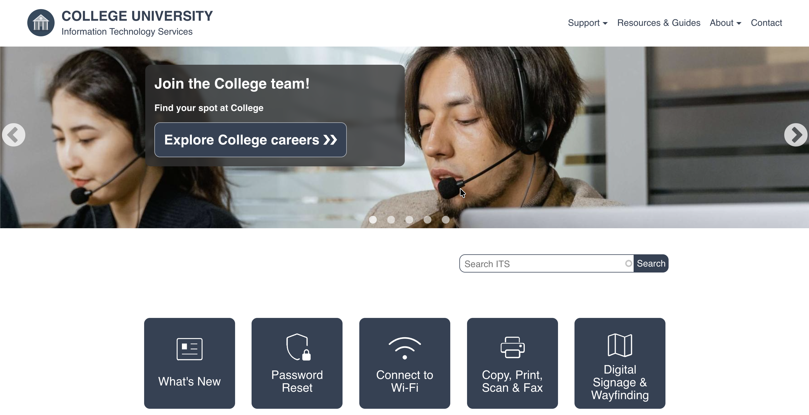

# College University ITS Website



This is a Drupal 10 demo site inspired by my work at a post-secondary institution. It is hosted on Pantheon and can be viewed at https://live-collegeuniversity.pantheonsite.io/.

Local development uses [DDEV](https://ddev.com/) and [OrbStack](https://orbstack.dev/) (or another Docker provider DDEV supports).

## Prerequisites

- [DDEV](https://ddev.com/get-started/)
- Docker via OrbStack (or another Docker provider supported by DDEV)

## Start the site

From the project root:

```bash
ddev start
ddev composer install
ddev launch
```

The site is at https://its-website.ddev.site.

One-time admin login:

```bash
ddev drush uli
```

Stop:

```bash
ddev stop
```

See [BACKUP.md](BACKUP.md) for database and files backup steps.

## Theme (Vite)

The custom theme (`web/themes/its`) is a Stable 9 subtheme. CSS and JavaScript are built with [Vite](https://vitejs.dev). Run these from the project root with DDEV running. 

`dist/` is committed so the site works without Node. After SCSS/JS changes, run `build` if you are not using `dev`.

Always use `ddev npm …` (not host `npm`) so native packages match Linux inside the container:

- `ddev npm --prefix web/themes/its ci` — install theme Node dependencies
- `ddev npm run build` — production build to `web/themes/its/dist/` (and slick overrides)
- `ddev npm run dev` — Vite HMR server (port 5173)
- `ddev npm run test` — run theme JS unit tests with [Vitest](https://vitest.dev/)
- `ddev npm run format` / `format:fix` — Prettier check / write (theme JS and SCSS)
- `ddev npm run lint` / `lint:fix` — ESLint check / fix (theme JS)
- `ddev npm run check` / `check:fix` — format + lint (check or fix)
- `ddev npm run validate` — `check` then `test` (same gate as Pantheon deploy)

### Vite HMR

This site uses Vite HMR for live style updates during development.

1. With DDEV running: `ddev npm run dev` (leave it running)
2. Once: `ddev drush cr` so Drupal switches from `dist/` to the Vite server
3. Open https://its-website.ddev.site and hard-refresh if needed. Do not open the `localhost:5173` URLs Vite prints — those are inside the DDEV container, not the Drupal site.

Confirm HMR in DevTools: asset URLs should point at `https://its-website.ddev.site:5173/…`, not `dist/assets/…`. 

Run `ddev drush cr` again after stopping or restarting Vite.

`web/sites/default/settings.local.php` should include:

```php
$settings['vite'] = [
  'devServerUrl' => ($_ENV['DDEV_PRIMARY_URL'] ?? 'https://its-website.ddev.site') . ':5173',
];
```

Keep CSS/JS aggregation off locally so HMR stays easy to debug. When Vite is not running, Drupal uses `dist/.vite/manifest.json`. Twig, PHP, and CMS content still use Drupal’s usual cache workflow.

### Theme layout

```
web/themes/its/
  src/scss/global.scss     sitewide styles (Vite entry)
  src/scss/pages/          page-only styles
  src/scss/components/     partials and component libraries
  src/js/global.js         sitewide behaviors entry
  src/js/behaviors/        shared Drupal.behaviors
  src/js/pages/            page-only behaviors
  dist/                    production build (committed)
  overrides/               slick and fieldgroup replacements
```

### Breakpoints

Defined in `its.breakpoints.yml` and `src/scss/abstracts/_breakpoints.scss` (also used by Responsive Image):

| Key | Label | Query |
| --- | --- | --- |
| `sm` | Small (mobile) | default / no media query |
| `md` | Medium (tablet) | `min-width: 48rem` (768px) |
| `lg` | Large (desktop+) | `min-width: 64rem` (1024px) |

This theme uses mobile-first styles, so the base ruleset is for mobile, and `@include breakpoint(md)` / `@include breakpoint(lg)` is used for larger viewports.

## Pantheon hosting

This project is hosted on a Pantheon sandbox at the below URLs. 

| Environment | URL |
| --- | --- |
| Dev | https://dev-collegeuniversity.pantheonsite.io/ |
| Test | https://test-collegeuniversity.pantheonsite.io/ |
| Live | https://live-collegeuniversity.pantheonsite.io/ |

### CI / branch flow

This project uses CI-CD to ensure code quality and automate deployments to Pantheon's **Dev**, **Test**, and **Live** environments. 

- PRs into `develop` run [`.github/workflows/ci.yml`](.github/workflows/ci.yml) (format, lint, test, then theme build).
- PRs into `main` must come from `develop` ([`.github/workflows/main-source-gate.yml`](.github/workflows/main-source-gate.yml)). 
- [`.github/workflows/deploy-pantheon.yml`](.github/workflows/deploy-pantheon.yml) runs on push to `develop` or `main` (after validate):

| GitHub branch | Pantheon                                                                                  |
| ------------- | ----------------------------------------------------------------------------------------- |
| `develop`     | Push → Pantheon **Dev**, promote → **Test** (staging — QA here before promoting to prod)  |
| `main`        | Push → Pantheon **Dev**, promote → **Test**, promote → **Live** (production)              |

GitHub must have repository secrets `PANTHEON_MACHINE_TOKEN` and `PANTHEON_SSH_KEY`, plus variable `PANTHEON_SITE` specifying the machine-name on Pantheon. Pantheon PATs expire after 90 days so this secret must be rotated every three months for automated deployment to work.

### One-time content import

After the first successful code deploy to Dev, import local DB and files once:

```bash
ddev start
ddev export-db --file=/tmp/its.sql.gz
terminus import:database collegeuniversity.dev /tmp/its.sql.gz

tar -C web/sites/default -czf /tmp/its-files.tar.gz files
terminus import:files collegeuniversity.dev /tmp/its-files.tar.gz

terminus env:deploy collegeuniversity.test --updatedb --note="Initial content" --yes
terminus env:deploy collegeuniversity.live --updatedb --note="Initial content" --yes
```

## Technology

- [DDEV](https://ddev.com/)
- [Drupal 10](https://new.drupal.org/)
- [MariaDB](https://mariadb.com/)
- [Vite](https://vite.dev/)
- [OrbStack](https://orbstack.dev/)
- [Pantheon](https://pantheon.io/)
